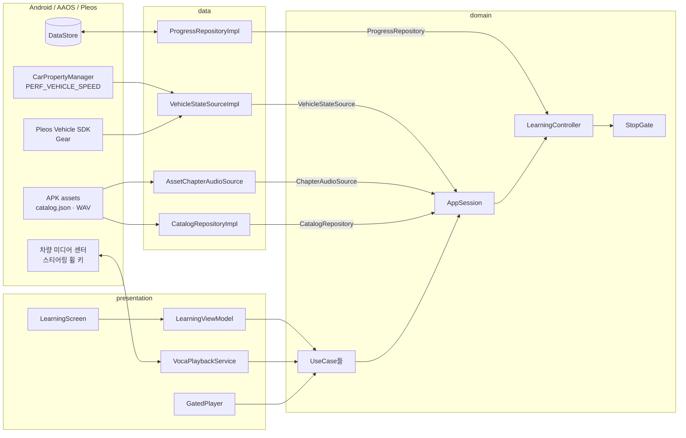
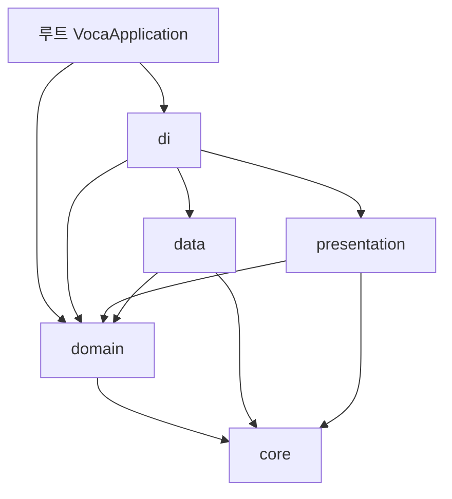
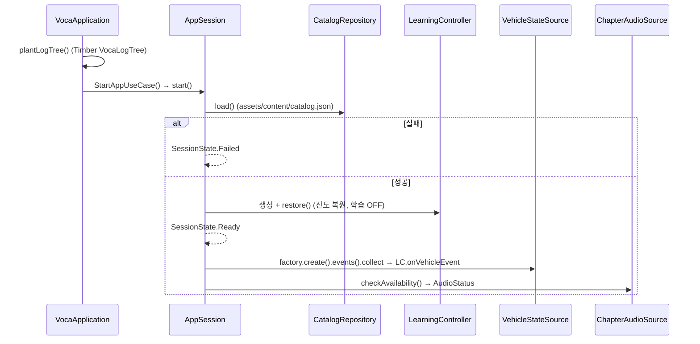
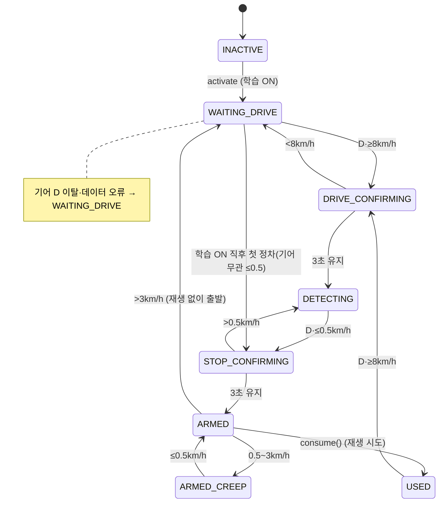
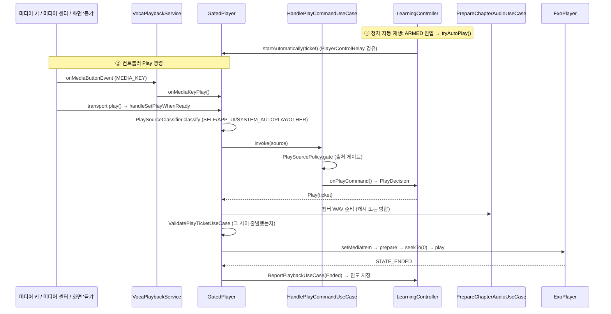
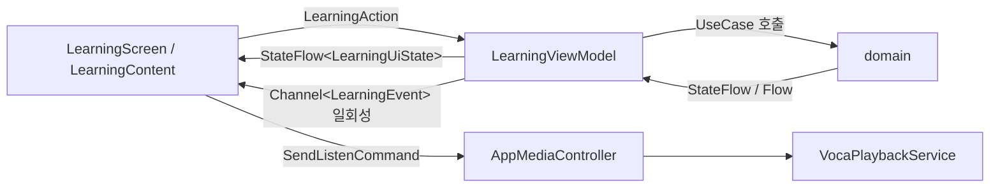

# 아키텍처

## 1. 전체 구조

단일 모듈(`:app`) 안에서 패키지(디렉터리)로 계층을 나눈다. 계층 = `app/src/<소스셋>/java/com/stai/pleos_red_light_voca_app/` 바로 아래 디렉터리.

```
com.stai.pleos_red_light_voca_app
├── VocaApplication.kt   # 루트: @HiltAndroidApp, 시작 시 StartAppUseCase 호출
├── core/                # 엔티티·공통 값·경계 인터페이스 (순수 Kotlin)
├── domain/              # 업무 규칙: 정차 판정, 학습 세션, 재생 허가, UseCase (순수 Kotlin)
├── data/                # 외부 세계 구현: 차량 SDK, assets, DataStore, 로그, 시계
├── presentation/        # Android 진입점: Activity·Compose 화면·ViewModel·Media3 서비스
└── di/                  # Hilt 모듈: 구현을 인터페이스에 묶어 조립
```



## 2. 계층별 책임

| 계층 | 책임 | 플랫폼 의존 |
|---|---|---|
| `core` | 엔티티(`Catalog`, `Progress`, `VehicleEvent` 등), 설정값(`LearningConfig`), 경계 인터페이스(`Logger`, `MonotonicClock`, `Scheduler`), 단위 변환 | 없음 |
| `domain` | 정차 판정(`StopGate`), 학습 세션(`LearningController`, `AppSession`), 재생 출처 규칙(`PlaySourcePolicy`), 읽기 순서(`ChapterScript`), 저장소·입력원 인터페이스, UseCase | 없음 (kotlinx.coroutines core만) |
| `data` | domain 인터페이스 구현: 차량 신호(Car API·Pleos SDK), 카탈로그 파싱, WAV 병합·캐시, 진도 저장(DataStore), Timber 로그, 단조 시계 | 있음 |
| `presentation` | Activity, Compose 화면, ViewModel, Media3 서비스·플레이어, 테마 | 있음 |
| `di` | Hilt 모듈. 구현을 domain 인터페이스로 묶고 프로세스 단위 객체를 제공 | 있음 |

## 3. 의존 규칙

`app/src/test/.../LayerDependencyTest.kt`가 main·debug·release 소스를 스캔해 강제한다. 테스트 소스셋(`test`, `testDebug`, `androidTest`)은 검사하지 않는다.



- **방향**: `presentation → domain ← data`, 모든 계층 → `core`. `core`는 다른 계층을 보지 않는다.
- **분리**: `presentation`과 `data`는 서로 보지 않고, 둘 다 `di`와 루트를 보지 않는다.
- **di는 조립만**: `di`는 `di`와 루트(`VocaApplication`)에서만 참조한다. 그래서 프로세스 스코프 한정자 `@ApplicationScope`는 `presentation`에 두고 `di`가 그것으로 제공한다.
- **루트**: `di`·`domain`·`core`와 플랫폼만 본다(`data`·`presentation`·Timber 금지).
- **순수성**: `core`·`domain`은 Android/androidx/Media3/Pleos/Timber/Hilt·Dagger/`javax.inject`/Guava/`org.json`/`kotlinx.coroutines.android`에 의존하지 않고 `Dispatchers.Main`을 쓰지 않는다. 그래서 domain UseCase에는 `@Inject`가 없고 `di/UseCaseModule`이 만든다.
- **Timber**: `data`·`presentation`·`di`에서만 쓴다. domain은 `core.common.Logger`를 쓴다.
- **presentation은 UseCase를 거친다**: domain 중 허용 목록만 참조한다.
  - 허용 패키지: `domain.usecase`
  - 허용 타입: `GatePhase`, `LearningState`, `PlaybackEnd`, `PauseReason`, `PlayTicket`, `PlaybackReport`, `PlayerControl`, `PlaybackPhase`, `PlaySource`, `PlayCommandResult`, `SessionState`, `AudioStatus`, `StartOutcome`, `ChapterAudioResult` (debug 소스셋만 `VehicleSimulator`, `SourceMode` 추가)
  - 명시 금지: `AppSession`, `LearningController`, `StopGate`, `PlayerControlRelay`, `ChapterScript`, `domain.repository`, `domain.source`
- **우회 방지**: domain에 금지 타입의 typealias를 두지 않고, UseCase 생성자 속성은 `private val`만 둔다.
- **변형**: main은 debug·release 한쪽에만 있는 최상위 선언을 보지 않는다(양쪽에 다 있으면 허용, 예: `DebugPanel`, `VariantModule`).
- **이름**: `domain/usecase` 클래스는 `…UseCase`, data의 저장소 구현은 `…Impl`, presentation의 `…Action`·`…Event`는 sealed interface, `…UiState`는 data class.

## 4. 스레드·수명 모델

- **프로세스 단위 세션 하나**: `AppSession`(Hilt `@Singleton`)이 `LearningController`를 하나 갖고, 화면(ViewModel)과 미디어 서비스(`VocaPlaybackService`, `GatedPlayer`)가 UseCase를 거쳐 같은 인스턴스를 공유한다.
- **메인 스레드 단일화**: `@ApplicationScope` 스코프 = `SupervisorJob() + Dispatchers.Main.immediate`. `AppSession`·`LearningController`·`StopGate`의 공개 메서드와 타이머 콜백은 모두 메인 스레드에서 실행되어 락 없이 상태를 다룬다.
- **비동기 예외**: 진도 저장은 `scope.launch` + `Mutex`로 호출 순서대로 직렬화하고, 음원 병합은 `Dispatchers.IO`에서 한다.
- **시간**: 연속 시간 판정은 이벤트 개수가 아니라 `MonotonicClock`(앱: `SystemClock.elapsedRealtime()`)과 `Scheduler`(앱: `CoroutineScheduler`)로 잰다. 테스트는 `TestScope` 가상 시간으로 바꾼다.

## 5. 주요 실행 흐름

### 5.1 앱 시작



앱 시작·서비스 연결만으로는 학습이 켜지지도, 재생되지도 않는다.

### 5.2 정차 판정 (`StopGate`)

| 상태 | 뜻 |
|---|---|
| `INACTIVE` | 학습 OFF |
| `WAITING_DRIVE` | 주행 확인 대기 |
| `DRIVE_CONFIRMING` | D단·8km/h 이상 연속 시간 측정 중 |
| `DETECTING` | 감지 활성, 정차 대기 |
| `STOP_CONFIRMING` | D단·0.5km/h 이하 연속 시간 측정 중 |
| `ARMED` | 정차 확정, 재생 가능 |
| `ARMED_CREEP` | 정차 확정 후 서행(0.5~3km/h), 새 재생 금지 |
| `USED` | 이번 정차의 재생 시도를 씀. 다시 주행해야 다음 정차 |



기준값은 모두 `core/common/LearningConfig.kt` 한 곳에 있다(`armSpeedKmh=8`, `armHoldMs=3000`, `stopSpeedKmh=0.5`, `stopHoldMs=3000`, `moveSpeedKmh=3.0`).

### 5.3 재생 경로

재생을 시작하는 길은 두 가지이고, 둘 다 `LearningController`의 판정과 `StopGate.consume()`을 거친다.



- **즉시 정지**: 속도 > 3km/h, 기어 D 이탈, 차량 신호 오류가 오면 `LearningController.haltPlayback()` → `PlayerControl.pause()` → `GatedPlayer`가 ExoPlayer를 멈춘다.
- **완료 판정**: `Player.STATE_ENDED`가 현재 티켓의 아이템에서 났을 때만 완료로 저장한다. 중단된 턴은 진도가 바뀌지 않아 다음 정차에서 처음부터 다시 재생한다.
- **오디오 포커스**: ExoPlayer `handleAudioFocus = true`(`USAGE_MEDIA`). 포커스를 잃으면 `PlaybackRules`에 따라 정지하고 자동 재개하지 않는다.
- **서비스 연결 유지**: 학습 ON 동안 `LearningServiceConnection`이 `MediaController`로 서비스에 바인딩해 두어, 정차 시 `GatedPlayer`가 붙어 있게 한다.

### 5.4 화면 (단방향 데이터 흐름)



화면 '듣기' 버튼도 앱 내부 `MediaController`(`AppMediaController`)로 세션에 명령을 보내므로 미디어 키와 같은 관문을 거친다. 앱이 플레이어 `play()`를 직접 부르는 경로는 없다.

## 6. 빌드 변형

| 항목 | debug | release |
|---|---|---|
| `di/VariantModule` | `SwitchingVehicleStateSource`로 실제/가짜 입력을 바꿔 끼움(기본 FAKE) | `@RealVehicleSource` 팩토리를 그대로 제공 |
| 차량 시뮬레이터 | `VehicleSimulator`(domain/source), `DebugVehicle`·`FakeVehicleStateSource`·`VehicleSimulatorImpl`(data/vehicle/debug) | 없음 |
| 디버그 UI | `DebugPanel`(속도·기어·실패 주입, 미디어 명령), 상태 카드 | `DebugPanel`은 빈 Composable |
| adb 주입 | `DebugVehicleReceiver` (`…debug.VEHICLE`, `…debug.MEDIA` 액션) | 없음 |
| 디버그 컨트롤러 출처 | `PlaySource.SELF` 인정(debuggable 빌드) | 인정 안 함 |

adb 예시(debug):

```bash
adb shell am broadcast -a com.stai.pleos_red_light_voca_app.debug.VEHICLE --ef speedKmh 30 --es gear DRIVE
```

## 7. 테스트 구조

| 소스셋 | 대상 |
|---|---|
| `test` | 계층 규칙(`LayerDependencyTest`, `CoreBoundaryTest`), domain 상태 기계(`StopGateTest`, `LearningControllerTest`), UseCase(`HandlePlayCommandUseCaseTest`), data 순수 로직(`WavCodecTest`, `MiniJsonTest`, `CatalogParserTest`, `GearLinkMonitorTest`, `VehicleMappingTest`, `AssetChapterAudioSourceTest`, `ProgressRepositoryImplTest`), presentation 순수 로직(`LearningCardTest`, `ListenButtonTest`, `PlaybackRulesTest`, `MediaIdsTest`, `PlaySourcePolicyTest`, `LearningViewModelTest`) |
| `testDebug` | `FakeVehicleStateSourceTest` |
| `androidTest` | 기본 예제만 |

Android 의존 코드는 얇게 두고 판단 로직은 순수 Kotlin으로 빼서 JVM 단위 테스트로 고정한다([design-patterns.md](design-patterns.md)의 Humble Object 참고).
